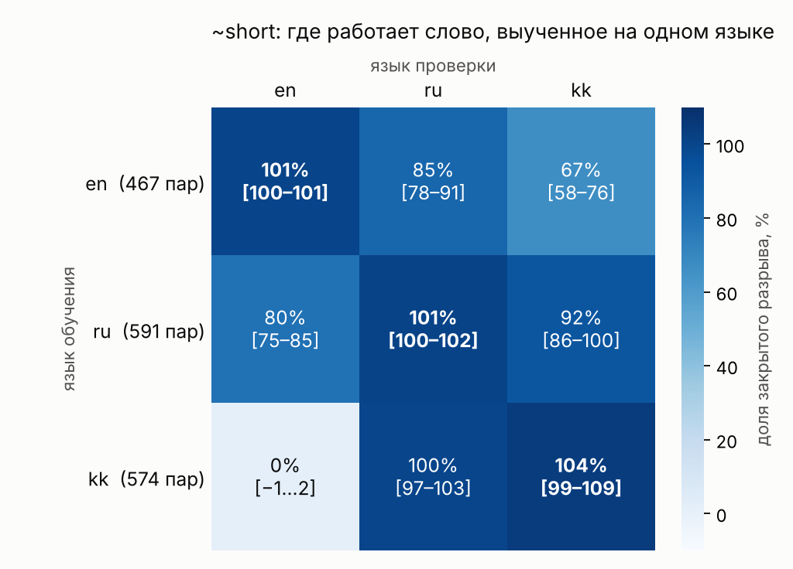
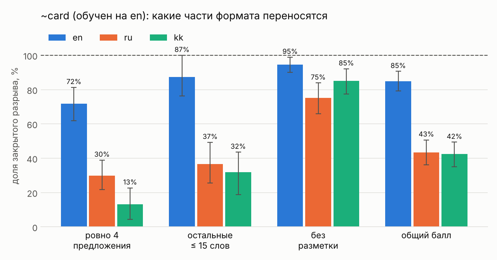

# Перенос неологизмов между языками: ~short и ~card

Доклад по курсу «Лингвистическая интерпретация языковых моделей».
Исходная статья: Hewitt, Geirhos, Kim, [«We Can't Understand AI Using our Existing Vocabulary»](https://arxiv.org/abs/2502.07586) (ICML 2025).

Неологизм — новое слово, которому обучают только вектор (эмбеддинг), а сама модель заморожена. Главный эксперимент доклада: если выучить такое слово на одном языке, будет ли оно работать на других? И нужно ли оно вообще, если можно просто попросить обычными словами?

Что сделано:

1. `~short` («ответь не длиннее двух предложений») выучен на английском и проверен на английском, русском и казахском.
2. Сравнение с обычными просьбами: явной инструкцией на языке вопроса, «дай короткий ответ» на родном языке, английскими фразами внутри русского и казахского вопроса.
3. Обратные направления: `~short` выучен на русском и на казахском. Проверено, как результат зависит от числа пар, их состава и случайности обучения.
4. Второе, сложное слово `~card` («ответ-карточка»: ровно 4 предложения, первое ≤ 20 слов, остальные ≤ 15, без разметки). Простого слова для такого формата нет. Выучено на английском, проверено на трёх языках, отдельно по каждому условию формата.

---

## Содержание

1. [Главные результаты](#главные-результаты)
2. [Как устроен эксперимент](#как-устроен-эксперимент)
3. [Структура репозитория](#структура-репозитория)
4. [Все пробеги: что это и чем запущено](#все-пробеги-что-это-и-чем-запущено)
5. [Что лежит в результатах](#что-лежит-в-результатах)
6. [Установка](#установка)
7. [Как воспроизвести](#как-воспроизвести)
8. [Ограничения](#ограничения)
9. [Источники](#источники)

---

## Главные результаты

Все числа — доля закрытого разрыва (что это, см. [ниже](#метрика)): 100% — как явная инструкция на языке вопроса, 0% — никакого эффекта. В квадратных скобках — 95% интервал (где он указан).

### ~short, обучен на английском (`runs/b002`)

| Приписка к вопросу | en | ru | kk |
| --- | --- | --- | --- |
| **~short** | **101%** [100–101] | **85%** [78–91] | **67%** [58–76] |
| «Дай короткий ответ» на языке вопроса | 93% | 96% | 100% |
| «Give me a short answer.» (по-английски) | 93% | 99% (по-русски 58% ответов) | 98% (по-казахски 89%) |
| «Answer in at most two sentences.» (по-английски) | — | 100% (по-русски 93%) | 89% (по-казахски 97%) |
| Контроль: необученный вектор | −4% | 1% | 4% |

### ~short, перенос в обе стороны

| Обучали на | Пар | en | ru | kk | Пробег |
| --- | --- | --- | --- | --- | --- |
| en | 467 | **101%** | 85% | 67% | `b002` |
| ru | 591 | 80% | **101%** | 92% | `from_ru` |
| ru | первые 467 | 21% | **102%** | 97% | `from_ru_467` |
| ru | первые 467, зерно 1 | 55% | **102%** | 94% | `from_ru_467s` |
| ru | последние 467 | 58% | **101%** | 90% | `from_ru_467b` |
| kk | 574 | 0% | 100% | **104%** | `from_kk` |
| kk | 467 | 0% | 102% | **103%** | `from_kk_467` |



Пробеги на всех парах (`b002`, `from_ru`, `from_kk`). Клетка ru → en неустойчива: на 467 парах разные зёрна и наборы пар дают от 21% до 58%.

### ~card, обучен на английском

| Приписка                                           | en      | ru                 | kk                     | Пробег               |
| -------------------------------------------------- | ------- | ------------------ | ---------------------- | -------------------- |
| **~card, стартовый вектор — «concise», шаг 0,003** | **85%** | **43%**            | **42%**                | `card_concise_lr003` |
| ~card, старт «concise», шаг 0,01                   | 79%     | 46%                | 57%                    | `card_concise`       |
| ~card, старт «accurate», шаг 0,01                  | 11%     | −5%                | 5%                     | `card_en`            |
| Контроль «concise» без обучения                    | 15%     | 18%                | 40%                    | `card_concise`       |
| «Ответь в четырёх предложениях» на языке вопроса   | 41%     | 46%                | 60%                    | `card_en`            |
| «Short» на языке вопроса                           | 19%     | 23%                | 43%                    | `card_en`            |
| Явная инструкция по-английски внутри ru/kk         | —       | 97% (по-русски 0%) | 108% (по-казахски 24%) | `card_en`            |

Перенос ~card по отдельным условиям (`card_concise_lr003`): «без разметки» en 95%, ru 75%, kk 85%; «ровно 4 предложения» en 72%, ru 30%, kk 13%.



Условие «первое предложение ≤ 20 слов» на графике не показано: без приписки оно и так выполняется в 77–93% ответов, и доля по нему ничего не говорит.

### Выводы в одном абзаце

Простое понятие (~short) переносится в другие языки хорошо, но его легко заменить обычным словом на родном языке. Перенос несимметричен: ru ↔ kk почти полный, а в английский слабый или нулевой; ru → en сильно зависит от случайности обучения. Сложное понятие (~card) обычными словами не заменить, но в другие языки оно переходит только частично и по частям: формат «без разметки» переносится, счёт предложений теряется. Дважды обучение выглядело идеальным по графику потерь, а слово не работало. Проверять неологизм надо по сгенерированным ответам.

---

## Как устроен эксперимент

### Модель и неологизм

- Модель — `google/gemma-3-4b-it` в bfloat16, все веса заморожены.
- Слово `~short` (или `~card`) добавлено только в токенизатор, но не в таблицу эмбеддингов модели. Перед подачей в модель текст переводится в векторы, и на место нового слова подставляется обучаемый вектор (через `inputs_embeds`). Поэтому сама модель это слово написать не может, а без него в промпте отвечает ровно как исходная.
- Стартовый вектор — копия эмбеддинга обычного слова: «accurate» для ~short, «accurate» или «concise» для ~card.
- Вектор хранится в нормированном виде: v = u · RMS, где RMS — типичный размер координаты обычных эмбеддингов. Так шаг обучения 0,01 означает сдвиг примерно на 1% типичной координаты.
- Gemma-3-4B — мультимодальная модель, и её класс не умеет `generate(inputs_embeds=...)`. Для генерации из тех же весов собирается текстовая модель (`generation_model()` в `neolib/common.py`), без копий весов.

### Данные

- Вопросы. 700 обучающих и 100 тестовых вопросов из датасета [LIMA](https://huggingface.co/datasets/GAIR/lima), как в статье. Если к LIMA нет доступа, `01_prepare_questions.py` берёт открытый Dolly-15k. В нашем запуске использовалась LIMA, см. `data/questions_source.txt`.
- Переводы. Тестовые вопросы сначала перевела сама Gemma, но качество было непригодным. Исправленные переводы сделал Claude: файлы `data/review_test_ru_fixed.tsv` и `data/review_test_kk_fixed.tsv`. 700 обучающих вопросов для обратных опытов на русский и казахский тоже перевёл Claude. Готовые переводы лежат в `data/`, и воспроизводить их не нужно.

### Обучающие пары

#### ~short (`03_make_pairs.py`)

На каждый обучающий вопрос модель отвечает дважды:
- без приписки — это будущий плохой ответ;
- с явной просьбой «Answer in at most two sentences.» на языке обучения — будущий хороший ответ.

Пара остаётся, если хороший ответ не длиннее 60 слов, хотя бы вдвое короче плохого и оба ответа на нужном языке. Получилось en 467 пар, ru 591, kk 574.

#### ~card (`08_card_pairs.py`)

- Хороший ответ — ответ на полную явную инструкцию, прошедший все 4 проверки формата. Если не прошёл, модель один раз переписывает свой ответ по той же инструкции.
- Плохой ответ наполовину «почти правильный» (короткий ответ на «ответь кратко, можно списками», но с нарушением формата), наполовину обычный длинный. Без «почти правильных» вектор выучил бы просто «покороче».
- Получилось 575 пар: 489 карточек с первого раза, 86 после переписывания.

### Обучение (`04_train.py`)

- В промпт вставляется «Give me a ~short answer.» (ru: «Дай ~short ответ.», kk: «Маған ~short жауап бер.»), для ~card то же с `~card`.
- Потеря — APO-up (DPO плюс «якорь», как в статье): хороший ответ должен обгонять плохой сильнее, чем со стартовым вектором, и сам становиться вероятнее. На старте потеря обязана быть 2·ln 2 = 1,386 — это встроенная проверка подсчёта.
- Рабочие настройки (уже в `config.py`): β = 0,02, AdamW, шаг 0,01, 2 эпохи, шаг оптимизатора после каждой пары.
- С β = 0,2 и шагом раз в 8 пар (пробег `short_en`) потеря насыщалась слишком рано: вектор почти не сдвигался, и слово не работало.

### Условия проверки

Каждый из 100 тестовых вопросов на каждом языке задаётся с одной из приписок. Генерация жадная, до 1024 новых токенов.

#### ~short (`05_evaluate.py`, `06_analyze.py`)

| Условие | en | ru | kk |
| --- | --- | --- | --- |
| `base` — без приписки | — | — | — |
| `neologism` — обученный вектор | Give me a ~short answer. | Дай ~short ответ. | Маған ~short жауап бер. |
| `target` — явная просьба, это 100% | Answer in at most two sentences. | Ответь не более чем в двух предложениях. | Ең көбі екі сөйлеммен жауап бер. |
| `target_en` — та же просьба по-английски | (= target) | Answer in at most two sentences. | Answer in at most two sentences. |
| `short_en` — обычное слово по-английски | Give me a short answer. | Give me a short answer. | Give me a short answer. |
| `short_native` — обычное слово на языке вопроса | (= short_en) | Дай короткий ответ. | Маған қысқа жауап бер. |
| `control` — необученный (стартовый) вектор | Give me a ~short answer. | Дай ~short ответ. | Маған ~short жауап бер. |

#### ~card (`09_card_evaluate.py`, `10_card_analyze.py`)

| Условие | Приписка |
| --- | --- |
| `base` | без приписки |
| `neologism` | Give me a ~card answer. / Дай ~card ответ. / Маған ~card жауап бер. |
| `target` — это 100% | полная инструкция на языке вопроса (`CARD_TEMPLATES` в `config.py`) |
| `target_en` | та же инструкция по-английски внутри ru/kk вопроса |
| `four` | «Answer in four sentences.» / «Ответь в четырёх предложениях.» / «Төрт сөйлеммен жауап бер.» |
| `short_en`, `short_native` | как у ~short |
| `control` | шаблон с `~card`, но с необученным вектором |

### Контроль

Контроль — тот же промпт, что с неологизмом, но на месте слова стартовый, необученный вектор. Для модели это по сути «Give me a accurate answer» или «Give me a concise answer». Он отделяет эффект обучения от эффекта самой фразы и стартового слова.

- Если контроль около 0%, весь эффект создало обучение. Так было у ~short и у ~card с «accurate».
- Если контроль заметно больше нуля, честный вклад обучения — разница между словом и контролем. Так у ~card с «concise», где «concise» само означает «кратко»: контроль даёт 15%, 18% и 40%.

### Метрика

#### ~short: длина ответа

```
доля закрытого разрыва = (L без приписки − L с условием) / (L без приписки − L с явной просьбой)
```

L — средняя длина ответа в словах. 100% — как явная просьба на том же языке, 0% — без эффекта, больше 100% — даже короче. Слова считаются как последовательности букв и цифр. Казахские слова длиннее (агглютинация), поэтому сравнивать между языками можно только доли, а не абсолютные длины.

#### ~card: формат ответа

Для каждого ответа проверяются 4 условия (`neolib/card.py`):

| Условие | Код |
| --- | --- |
| ровно 4 предложения | `count` |
| первое предложение ≤ 20 слов | `first` |
| остальные предложения ≤ 15 слов | `rest` |
| нет разметки: заголовков, списков, `**жирного**`, кода, таблиц, цитат, эмодзи | `plain` |

Балл ответа — доля выполненных условий (0; 0,25; …; 1). Доля закрытого разрыва = (балл с условием − балл без приписки) / (балл с явной инструкцией − балл без приписки). То же считается отдельно по каждому условию и по «выполнены все 4».

Интервалы — 95%, бутстрэп по вопросам, 1000 повторов.

---

## Структура репозитория

```
config.py                  все настройки: модель, языки, приписки, параметры обучения, ~card
requirements.txt           библиотеки (PyTorch ставится отдельно, см. «Установка»)

00_check_setup.py          шаг 0: проверка среды и модели
01_prepare_questions.py    шаг 1: 700 + 100 вопросов из LIMA (или Dolly)
02_translate.py            шаг 2: перевод вопросов (моделью или импорт готового TSV)
03_make_pairs.py           шаг 3: пары для ~short
04_train.py                шаг 4: обучение вектора (~short или ~card)
05_evaluate.py             шаг 5: ответы на тест для ~short
06_analyze.py              шаг 6: таблица и графики для ~short
07_diagnose.py             диагностика, если ~short учится, но не работает (только для ~short)
08_card_pairs.py           пары для ~card
09_card_evaluate.py        ответы на тест для ~card
10_card_analyze.py         таблица и графики для ~card
11_figures.py              два итоговых графика для README (из готовых результатов)

neolib/common.py           модель, вставка вектора, вероятность ответа, потеря, генерация
neolib/metrics.py          длина ответа, язык ответа, доля разрыва, бутстрэп (без PyTorch)
neolib/card.py             деление на предложения, проверка формата ~card (без PyTorch)
neolib/files.py            чтение и запись файлов (без PyTorch)

tests/test_metrics.py      проверки подсчётов, без видеокарты
tests/test_card.py         проверки формата ~card, без видеокарты

data/                      вопросы, переводы, обучающие пары
runs/                      все пробеги: векторы, логи, ответы, таблицы, графики
figures/                   итоговые графики для README
```

### Что лежит в `data/`

| Файл | Что в нём |
| --- | --- |
| `questions_source.txt` | откуда взяты вопросы (`lima`) |
| `questions_train_en.jsonl` | 700 обучающих вопросов |
| `questions_train_ru.jsonl`, `questions_train_kk.jsonl` | их переводы (Claude) |
| `questions_test_en.jsonl`, `_ru`, `_kk` | 100 тестовых вопросов на каждом языке |
| `review_test_ru_fixed.tsv`, `review_test_kk_fixed.tsv` | исправленные переводы тестовых вопросов (Claude), из них собраны `questions_test_ru/kk.jsonl` |
| `review_test_*.tsv`, `review_train_*.tsv` | переводы рядом с оригиналом и автоматические пометки о подозрительных местах |
| `raw_pairs_{en,ru,kk}.jsonl` | сырые ответы модели для пар ~short (обычный и короткий ответ на каждый вопрос) |
| `pairs_{en,ru,kk}.jsonl` | отобранные пары ~short: 467, 591, 574 |
| `raw_card_en.jsonl` | сырые ответы для пар ~card (карточка, переписанная карточка, «почти правильный» ответ) |
| `pairs_card_en.jsonl` | 575 пар ~card |

---

## Все пробеги: что это и чем запущено

Пробеги перечислены в том порядке, в каком запускались. Команды выполняются в PowerShell из папки проекта, перед каждой — `python`. Порядок важен: флаг `--reuse-from` берёт готовые ответы из более раннего пробега.

| Пробег               | Что это                                                                                                                            | Команды                                                                                                                                                                                                                                                                                               |
| -------------------- | ---------------------------------------------------------------------------------------------------------------------------------- | ----------------------------------------------------------------------------------------------------------------------------------------------------------------------------------------------------------------------------------------------------------------------------------------------------- |
| `short_en`           | первая попытка ~short на en (β = 0,2, шаг раз в 8 пар): потеря упала почти до нуля, но слово не заработало; оставлен для сравнения | `04_train.py --lang en --run short_en --beta 0.2 --grad-accum 8` → `05_evaluate.py --run short_en --langs en --limit 20 --out quick.jsonl`                                                                                                                                                            |
| `b002`               | вторая попытка ~short на en с рабочими настройками — основной пробег + все базовые линии                                           | `03_make_pairs.py --lang en` → `04_train.py --lang en --run b002` → `05_evaluate.py --run b002 --langs en ru kk` → `05_evaluate.py --run b002 --langs ru kk --conditions target_en short_en short_native` → `05_evaluate.py --run b002 --langs en --conditions short_en` → `06_analyze.py --run b002` |
| `from_ru`            | ~short на ru, все 591 пара                                                                                                         | `03_make_pairs.py --lang ru` → `04_train.py --lang ru --run from_ru` → оценка¹                                                                                                                                                                                                                        |
| `from_kk`            | ~short на kk, все 574 пары                                                                                                         | `03_make_pairs.py --lang kk` → `04_train.py --lang kk --run from_kk` → оценка¹                                                                                                                                                                                                                        |
| `from_ru_467`        | ru, первые 467 пар                                                                                                                 | `04_train.py --lang ru --run from_ru_467 --limit 467` → оценка¹                                                                                                                                                                                                                                       |
| `from_kk_467`        | kk, первые 467 пар                                                                                                                 | `04_train.py --lang kk --run from_kk_467 --limit 467` → оценка¹                                                                                                                                                                                                                                       |
| `from_ru_467b`       | ru, последние 467 пар (другой состав)                                                                                              | `04_train.py --lang ru --run from_ru_467b --offset 124 --limit 467` → оценка¹                                                                                                                                                                                                                         |
| `from_ru_467s`       | ru, первые 467 пар, другое зерно                                                                                                   | `04_train.py --lang ru --run from_ru_467s --limit 467 --seed 1` → оценка¹                                                                                                                                                                                                                             |
| `card_en`            | ~card на en, старт «accurate» (не выучился)                                                                                       | `08_card_pairs.py --lang en` → `04_train.py --concept card --lang en --run card_en` → `09_card_evaluate.py --run card_en --reuse-from b002` → `10_card_analyze.py --run card_en`                                                                                                                      |
| `card_concise`       | ~card, старт «concise», шаг 0,01                                                                                                  | `04_train.py --concept card --lang en --run card_concise --init-word concise` → `09_card_evaluate.py --run card_concise --reuse-from card_en` → `10_card_analyze.py --run card_concise`                                                                                                               |
| `card_concise_lr003` | ~card, старт «concise», шаг 0,003 (лучший)                                                                                        | `04_train.py --concept card --lang en --run card_concise_lr003 --init-word concise --lr 0.003` → `09_card_evaluate.py --run card_concise_lr003 --reuse-from card_concise` → `10_card_analyze.py --run card_concise_lr003`                                                                             |

¹ Оценка для обратных пробегов (подставить имя пробега):

```
python 05_evaluate.py --run ИМЯ --langs en ru kk --conditions base neologism target target_en short_en short_native control --reuse-from b002
python 06_analyze.py --run ИМЯ
```

Что делает `--reuse-from`. Ответы, не зависящие от обученного вектора (без приписки, с явной просьбой, с обычными словами), при жадной генерации получаются одинаковыми в любом пробеге. Скрипт копирует их из указанного пробега и генерирует заново только ответы со словом. Контроль копируется, только если стартовый вектор совпадает. В `09_card_evaluate.py` дополнительно проверяется, что текст приписки совпадает до буквы, поэтому чужая «явная просьба» не подмешается.

---

## Что лежит в результатах

Каждый пробег — папка `runs/ИМЯ/`:

| Файл                                         | Что в нём                                                                                                |
| -------------------------------------------- | -------------------------------------------------------------------------------------------------------- |
| `settings.json`                              | с какими настройками учили: модель, слово, стартовое слово, язык, число пар, сдвиг, зерно, эпохи, шаг, β |
| `neologism.pt`                               | обученный вектор и стартовый вектор (для контроля)                                                       |
| `neologism_epoch1.pt`, `neologism_epoch2.pt` | вектор после каждой эпохи                                                                                |
| `ref_logprobs.pt`                            | опорные вероятности со стартовым вектором                                                                |
| `log.csv`                                    | каждые 25 пар: потеря, рост вероятности хорошего и плохого ответа, доля верных, норма вектора, время     |
| `generations.jsonl`                          | все ответы модели: вопрос, условие, приписка, ответ, длина, обрезан ли, определённый язык                |
| `summary.csv`                                | итоговая таблица по языкам и условиям                                                                    |
| `gap_closure.png`, `words.png`               | ~short: доля закрытого разрыва и средняя длина по условиям                                               |
| `criteria.csv`                               | ~card: доля разрыва по каждому условию формата                                                           |
| `card_closure.png`, `card_criteria.png`      | ~card: доля разрыва по баллу и выполнение каждого условия                                                |

Столбцы `summary.csv` у ~short: `lang`, `condition`, `n` (число ответов), `mean_words`, `median_words`, `truncated_share` (доля обрезанных лимитом), `right_lang_share` (доля ответов на языке вопроса), `gap_closure` и `ci_low`, `ci_high` (доля разрыва и 95% интервал).

Столбцы `summary.csv` у ~card: те же первые, плюс `score` (средний балл), `full` (доля «выполнены все 4»), `count`, `first`, `rest`, `plain` (доля ответов, выполнивших условие), `score_closure`, `full_closure` с интервалами.

Анализ можно пересчитать из сохранённых ответов: `python 06_analyze.py --run b002` или `python 10_card_analyze.py --run card_concise_lr003`.

---

## Установка

Все пробеги сделаны на Windows, в PowerShell, Python 3.12. Версии библиотек закреплены в `requirements.txt`.

1. Свежий драйвер NVIDIA и Python 3.11 или 3.12.
2. В папке проекта:

```
python -m venv .venv
.venv\Scripts\activate
pip install torch==2.14.1 --index-url https://download.pytorch.org/whl/cu126
pip install -r requirements.txt
```

3. Аккаунт на Hugging Face. Примите лицензию на странице [Gemma 3](https://huggingface.co/google/gemma-3-4b-it) и войдите: `hf auth login`, затем вставьте токен из Settings → Access Tokens. Доступ к [LIMA](https://huggingface.co/datasets/GAIR/lima) нужен, только если собирать вопросы заново.
4. Проверка: `python -c "import torch; print(torch.cuda.is_available())"` должно напечатать `True`.

Модель скачается при первом запуске.

---

## Как воспроизвести

### Вариант А. Только анализ

Все ответы сохранены, таблицы и графики пересчитываются из них:

```
python tests/test_metrics.py
python tests/test_card.py
python 06_analyze.py --run b002
python 10_card_analyze.py --run card_concise_lr003
python 11_figures.py
```

### Вариант Б. Полный эксперимент на готовых данных

Вопросы и переводы уже в `data/`, шаги 1 и 2 пропускаются. Каждая команда — одна строка PowerShell.

```
# 0. Проверка среды (~10 мин в первый раз из-за скачивания модели)
python 00_check_setup.py

# 1. ~short на английском + базовые линии (~1,5 ч)
python 03_make_pairs.py --lang en
python 04_train.py --lang en --run b002
python 05_evaluate.py --run b002 --langs en ru kk
python 05_evaluate.py --run b002 --langs ru kk --conditions target_en short_en short_native
python 05_evaluate.py --run b002 --langs en --conditions short_en
python 06_analyze.py --run b002

# 2. Обратные направления (~30 мин на сбор пар для языка, ~25 мин на каждый пробег)
python 03_make_pairs.py --lang ru
python 03_make_pairs.py --lang kk
python 04_train.py --lang ru --run from_ru
python 05_evaluate.py --run from_ru --langs en ru kk --conditions base neologism target target_en short_en short_native control --reuse-from b002
python 06_analyze.py --run from_ru
# то же для from_kk (--lang kk) и для пробегов с --limit 467, --offset 124, --seed 1 (см. таблицу пробегов)

# 3. ~card (~15 мин пары, ~10 мин обучение, ~15–25 мин оценка на пробег)
python 08_card_pairs.py --lang en
python 04_train.py --concept card --lang en --run card_en
python 09_card_evaluate.py --run card_en --reuse-from b002
python 10_card_analyze.py --run card_en
python 04_train.py --concept card --lang en --run card_concise --init-word concise
python 09_card_evaluate.py --run card_concise --reuse-from card_en
python 10_card_analyze.py --run card_concise
python 04_train.py --concept card --lang en --run card_concise_lr003 --init-word concise --lr 0.003
python 09_card_evaluate.py --run card_concise_lr003 --reuse-from card_concise
python 10_card_analyze.py --run card_concise_lr003
```

Чтобы не затереть сохранённые результаты, используйте другие имена пробегов, например `b002_repro`. Тогда во всех `--reuse-from` подставьте свои новые имена.

Несколько команд можно запустить подряд, соединив их через `;` в одной строке.

Пробный прогон перед долгими запусками (~10 мин, ловит ошибки):

```
python 03_make_pairs.py --lang en --limit 32
python 04_train.py --lang en --run test_run --limit 20 --epochs 1
python 05_evaluate.py --run test_run --langs en --limit 5 --out quick.jsonl
python 06_analyze.py --run test_run --file quick.jsonl
```

После пробы запустите `03_make_pairs.py` снова без `--limit`: файл пар перезапишется.

### Вариант В. С самого начала, включая вопросы и переводы

```
python 01_prepare_questions.py
python 02_translate.py --lang ru --mode import --file data\review_test_ru_fixed.tsv
python 02_translate.py --lang kk --mode import --file data\review_test_kk_fixed.tsv
```

Перевод обучающих вопросов на ru и kk делался вне кода: TSV выгружался командой `02_translate.py --lang ru --split train --mode export`, переводился Claude и загружался обратно (`--split train --mode import --file … --column N`). Тот же перевод заново не получить. Используйте готовые `data/questions_train_ru.jsonl` и `data/questions_train_kk.jsonl`.

Если к LIMA нет доступа, `01_prepare_questions.py` возьмёт Dolly-15k. Вопросы будут другими, результаты с нашими не сравнить.

---

## Ограничения

- Одна модель (Gemma-3-4B) и по одному пробегу на большинство настроек, а разброс между пробегами бывает большим.
- По 100 тестовых вопросов на язык; три языка, из них два на кириллице.
- Переводы сделаны нейросетью.
- Измеряется только форма ответа (длина, предложения, разметка), а не правильность и качество содержания.
- Лимит 1024 токена обрезает 40–60% длинных ответов без приписки, поэтому их настоящая длина больше. Из-за этого доли для ru и kk немного занижены.
- Проверка формата ~card сделана правилами и может ошибаться на сокращениях и необычной пунктуации.
- ~card учили только на английском. Для казахского почти весь эффект ~card даёт само стартовое слово «concise».

---

## Источники

- Hewitt, Geirhos, Kim. [We Can't Understand AI Using our Existing Vocabulary](https://arxiv.org/abs/2502.07586). ICML 2025.
- [LIMA](https://huggingface.co/datasets/GAIR/lima) (Zhou et al., 2023) — вопросы.
- [google/gemma-3-4b-it](https://huggingface.co/google/gemma-3-4b-it) — модель.
- D'Oosterlinck et al. Anchored Preference Optimization (APO) — функция потерь.
